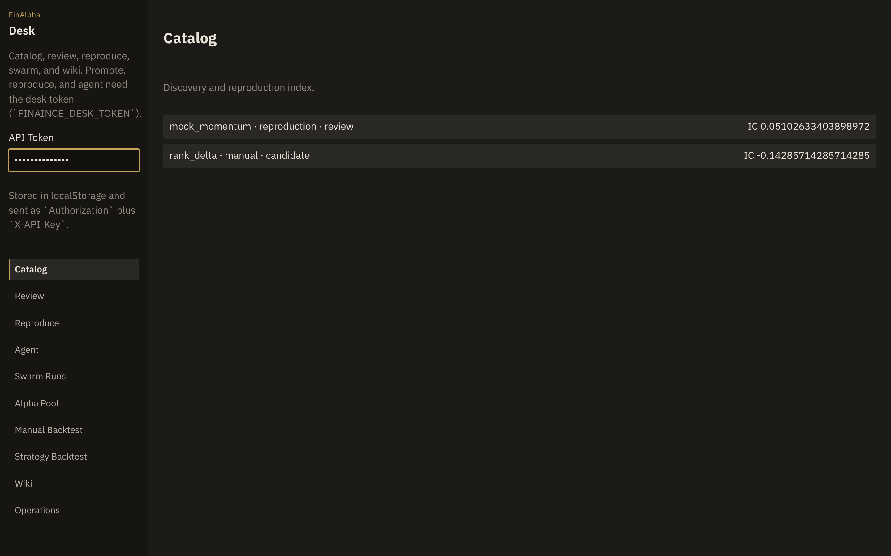

# FinAlpha

**English** · [中文](README.zh-CN.md)

FinAlpha (`finaince` on PyPI/uv) is a local research desk for China A-share factor work and sell-side report (研报) reproduction. It keeps candidate factors in a local SQLite catalog, scores them across explicit evaluation cores, blocks promotion whenever provenance or statistical gates fail, and reproduces broker PDFs through `reproagent` and `finpdfpro`.

- **[Product Handbook (中文)](docs/handbook.md)** — end-to-end walkthrough, CLI reference, HTTP API contract, and workbench screenshots.



---

## Design Premises

1. **Fail-closed promotion.** A factor cannot enter the pool if its panel has fewer than 20 stocks (`thin_panel`), if it relies on a placeholder formula (`formula_proxy`), if its evaluation core is non-citable (`not_citable`), or if it fails multiple-testing and structural deduplication checks (`weak_ic`, `inflated_sharpe`, `homogeneous`, `overcomplex`).
2. **Adversarial verification on approval.** Approving a promotion spawns a fresh subprocess to re-evaluate the factor independently and checks that IC and Sharpe match the catalog record within tolerance. Over HTTP, neither gate overrides nor skipping the adversary is permitted.
3. **Explicit provenance on every number.** The repository ships a two-stock `local_panel` fixture (2023-01-03 to 2023-02-10, 0 bps) strictly as an installation smoke test (`finaince baseline`). Real research requires either a point-in-time CSI300 parquet cache (`finaince bench`) or a full market panel via `FINAINCE_PANEL_PATH` / RiceQuant.

---

## Installation (Python 3.12)

Clone this repository and install with `uv`. The reproduction and discovery engines are pulled directly from public GitHub repositories at pinned commits declared in `pyproject.toml`.

```bash
git clone https://github.com/WeissHymmnos/finaince.git
cd finaince
uv venv --python 3.12 .venv
source .venv/bin/activate
uv pip install -e ".[reproduction]"
cp .env.example .env   # set FINAINCE_DESK_TOKEN before starting the server
finaince doctor
```

`finaince doctor` verifies imports (`finaince`, `reproagent`, `aiminer`), database paths, the local panel, and the Qlib evaluation child, exiting `0` only when every check passes.

Optional extras:
- `.[discovery]` — `aiminer` factor discovery swarm
- `.[gbm]` — LightGBM curve-timing head
- `.[agent]` — Claude Agent SDK integration
- `.[dev]` — `pytest`, `pytest-cov`, `ruff`
- `.[all]` — all optional dependencies

By default, `finaince serve` binds to `127.0.0.1:8000` and requires `FINAINCE_DESK_TOKEN` for all `/api/v1` reads and writes (except `/api/v1/health` and `/api/v1/baseline`). Binding to `0.0.0.0` requires `FINAINCE_ALLOW_PUBLIC_BIND=1`. The Python wheel includes a lightweight zero-build workbench (`finaince/web/index.html`); if a built `aiminer/frontend/dist` directory is present alongside the checkout, `finaince serve` mounts the full SPA unless `FINAINCE_PACKAGED_SPA=1` is set.

---

## 15-Minute Walkthrough

The commands below run against the shipped two-stock `local_panel` fixture. See [docs/handbook.md](docs/handbook.md) for annotated screenshots of each step.

```bash
# 1. Verify environment and run the locked install probe
finaince doctor
finaince baseline

# 2. Evaluate expressions on the local panel (repro_polars and qlib dialects)
finaince eval "Rank(Delta(close, 1))" --dialect repro_polars --backend local
finaince eval 'Rank($close)' --dialect qlib --backend local

# 3. Run an isolated Python factor implementation and record it in the catalog
finaince impl examples/15min/compute.py --name rank_delta --universe local_panel

# 4. Enqueue the candidate for promotion and inspect the review queue
finaince promote '<catalog_id>' --to to_pool --yes
finaince review

# 5. Run review approval (triggers adversarial subprocess re-evaluation)
finaince review --approve '<promotion_id>' --override thin_panel

# 6. Launch the local web workbench
finaince serve --host 127.0.0.1 --port 8000
```

Note on Step 5: `--override thin_panel` bypasses only the 20-stock minimum for smoke testing. Because the two-stock `local_panel` run comes from `engine_native` (`citable=False`), the non-overridable `not_citable` gate still prevents smoke-test artifacts from entering the production pool.

---

## Evaluation Cores & Data Tracks

FinAlpha separates installation smoke tests from citable point-in-time benchmarks across three evaluation cores (`pit_core`, `engine_native`, and `qlib`). `finaince doctor` reports their readiness under `evaluation_cores`.

### 1. Locked Install Probe (`finaince baseline`)

`finaince baseline` (and `run_locked_baseline()`) evaluates a fixed configuration to verify that the calculation stack is deterministic:

| Parameter | Value |
|---|---|
| Window | `2023-01-03` → `2023-02-10` |
| Universe | `local_panel` (2 stocks, 56 rows) |
| Cost | `0 bps` |
| Expression | `Rank(Delta(close, 1))` |
| Dialect | `repro_polars` |

Two consecutive runs must produce identical `ok`, IC, and Sharpe values. Numbers from `local_panel` are smoke-test outputs and must never be cited as empirical alpha.

### 2. Point-in-Time CSI300 Track (`finaince bench` & `--backend pit`)

For empirical evaluation on a point-in-time universe:
- Set `RQ_USER` and `RQ_PASS` (or `RQ_TOKEN`) and run `finaince bench --sync` to populate the local point-in-time CSI300 parquet cache (`sha256`-verified yearly frames, semi-annual constituent snapshots, post-adjusted prices, suspension and limit-move filters).
- Or point `FINAINCE_PANEL_PATH` at your own parquet panel matching the `prices.parquet` schema (`trade_date`, `ts_code`, `open`, `high`, `low`, `close`, `volume`, `amount`).

`finaince bench` and `finaince eval --backend pit` share the same vectorized point-in-time evaluation core (`engine=pit_core`), charging double-sided transaction costs against quintile membership churn and enforcing last-day window embargoes.

---

## Core Capabilities

- **Sell-side PDF reproduction (`finaince reproduce` & `finaince campaign`)** — Extracts formulas and backtest specs from Chinese broker reports via `finpdfpro` + `reproagent`, supports batch directory campaigns with checkpoint resume, and records `no_factors` honestly when a report contains no testable signal.
- **Promotion gates (`src/finaince/review/gates.py`)** — Enforces provenance (`unprovenanced`, `not_citable`), sample depth (`thin_panel`), statistical significance (`weak_ic` with Harvey–Liu $t \ge 3.0$, `inflated_sharpe` via Bailey–López de Prado Deflated Sharpe Ratio), return correlation caps (`correlated`), and AST-level structural checks (`homogeneous` subtree similarity $\le 0.85$, `overcomplex` token/parameter bounds).
- **Operator-template grid screening (`finaince sweep` & `finaince wf-candidates`)** — Evaluates template $\times$ field $\times$ window grids and per-year walk-forward folds on the PIT core to map where IC lives before committing candidates to the research loop.
- **Sandboxed code factors (`finaince impl` & `code_evolution.py`)** — Static AST allowlist validation plus optional `bwrap --unshare-all` network-isolated execution for `compute(panel)` factors, paired with error-prefix failure retrieval for iterative rewrites.
- **Dynamic factor combination (`combination.py`)** — Combines `ready` (`pit_core`) factor return series using strictly causal ($t-1$) trailing inverse-volatility weights net of L1 weight-turnover costs.
- **Research loop & process memory (`finaince loop`)** — Alternates factor evaluation steps with walk-forward curve-timing heads (`FINAINCE_MODEL_HEAD=ols|gbm`), crediting AST edit motives in process memory only when a candidate survives both gates and adversarial re-evaluation.

For how FinAlpha compares with unattended Qlib loops like RD-Agent, see the historical notes in [docs/rdagent-gap.md](docs/rdagent-gap.md) and [docs/competitor-analysis.md](docs/competitor-analysis.md).

---

## Testing

Run the offline test suite (no network or external credentials required):

```bash
uv run pytest -q -m "not live"
```

Check coverage on the core governance modules (82% minimum enforced in CI):

```bash
uv run pytest tests --ignore=tests/test_live_real.py \
  --cov=finaince.expr_ast --cov=finaince.db --cov=finaince.data_track \
  --cov=finaince.combination --cov=finaince.code_evolution --cov=finaince.corpus_campaign \
  --cov=finaince.brain_track --cov=finaince.process_memory --cov=finaince.domain.scoring
```

Live integration tests (RiceQuant data sync, real PDF parsing, live LLM queries) are opt-in via `pytest -m live`.

---

## Contributing & License

See [CONTRIBUTING.md](CONTRIBUTING.md) for development setup and PR requirements.

Licensed under the [GNU Affero General Public License v3.0](LICENSE). See [NOTICE](NOTICE) for copyright and third-party engine attributions.
