# FinAlpha 产品手册

本手册对应公开仓库 [`WeissHymmnos/finaince`](https://github.com/WeissHymmnos/finaince) 的 `main` 分支（Python 包名 `finaince`，产品名 **FinAlpha**）。文中所有界面截图均来自本机运行的 `finaince serve`（监听 `127.0.0.1:8000`，已配置 `FINAINCE_DESK_TOKEN`）。

许可证：[AGPL-3.0](../LICENSE) · 版权与第三方组件声明：[NOTICE](../NOTICE)

---

## 1. 系统定位与工作流

FinAlpha 用于在本地管理卖方研报复现与选股因子评测：
1. **入库（Catalog）**：通过研究主循环（`loop._catalog_candidate`）或沙箱代码实现（`finaince impl` / `isolate.upsert_isolated`）将候选因子登记到本地 SQLite 目录；或通过 `finaince reproduce` 从券商 PDF 研报中抽取公式并回测入库。
2. **评测（Eval / Bench）**：`finaince eval` 与 `finaince bench` 负责计算并输出因子指标（评测命令本身只读，不会自动往目录写记录）。各评测核是否可引用（`citable`）及目录写入规则可通过 `finaince doctor` 输出的 `evaluation_cores` 字段查看。
3. **晋升与复核（Promote → Review → Pool）**：候选因子提交晋升后进入待审队列，必须通过默认拒止（fail-closed）的门禁检查与独立子进程对抗重评，才能进入正式因子池（Pool）。

安装包内自带一份仅含两只股票的迷你行情面板 `local_panel`（`2023-01-03` 至 `2023-02-10`，交易成本 `0 bps`，测试公式 `Rank(Delta(close, 1))`）。`finaince baseline` 输出的 IC 与 Sharpe 仅用于确认本地安装与计算链路正常，不能当作实证研究结论引用。

---

## 2. 安装与环境准备（Python 3.12）

克隆本仓库并使用 `uv` 安装即可。复现与挖掘引擎会自动从 `pyproject.toml` 中锁定的公开 GitHub commit 拉取：

```bash
git clone https://github.com/WeissHymmnos/finaince.git
cd finaince
uv venv --python 3.12 .venv
source .venv/bin/activate
uv pip install -e ".[reproduction]"
cp .env.example .env
# 编辑 .env，设置非空的 FINAINCE_DESK_TOKEN
finaince doctor
```

当 `finaince doctor` 返回的 JSON 中 `"ok": true` 时，进程退出码为 `0`。安装完成后，以下导入应能正常执行：

```python
import finaince, reproagent
from aiminer.manager import cull_alpha_pool
```

### 可选依赖组（Extras）

| 依赖组 | 用途 |
|---|---|
| `.[reproduction]` | 研报复现、Catalog 管理与因子评测（标准安装必选） |
| `.[discovery]` | `aiminer` 多智能体因子挖掘 |
| `.[gbm]` | LightGBM 曲线择时模型头 |
| `.[agent]` | Claude Agent SDK 研究台对话支持 |
| `.[dev]` | `pytest`、`pytest-cov`、`ruff` 开发测试工具 |
| `.[all]` | 一次性安装上述全部可选依赖 |

### Web 前端说明

Python 安装包内自带零构建依赖的三栏式轻量工作台（`finaince/web/index.html`）。若同级目录下存在编译好的 `aiminer/frontend/dist`，`finaince serve` 会优先挂载完整的 React 前端；设置 `FINAINCE_PACKAGED_SPA=1` 可强制使用内置轻量页。

---

## 3. 十五分钟完整操作示例

下面每一步均为真实可执行的 CLI 命令，手册中的工作台截图即在执行完同一套命令后截取。

### 3.1 环境自检

```bash
export FINAINCE_DATA_SOURCE=local
export ALLOW_MOCK_LLM=true          # 仅用于离线演示；已配置真实 LLM 时请勿开启
export FINAINCE_DESK_TOKEN=desk-local
finaince doctor
```

正常情况下输出 `"ok": true`，`"imports"` 下的 `finaince`、`aiminer`、`reproagent` 均为 `true`，且 `qlib_child.via` 显示为 `qlib_child`。

### 3.2 运行安装探针基准

```bash
finaince baseline
```

该命令与内置 `local_panel` 强绑定，连续运行两次输出的 `ok`、IC 与 Sharpe 必须完全一致：

```json
{
  "ok": true,
  "window": {
    "start": "2023-01-03",
    "end": "2023-02-10",
    "universe": "local_panel",
    "cost_bps": 0,
    "dialect": "repro_polars",
    "expression": "Rank(Delta(close, 1))",
    "note": "install smoke local_panel fixture; cost 0 bps"
  },
  "metrics": {
    "ic_mean": "<smoke only>",
    "sharpe_ratio": "<smoke only>",
    "rows": 56,
    "universe_claim": "local_panel",
    "transaction_cost_bps": 0.0
  },
  "claim": "install smoke local_panel fixture; cost 0 bps"
}
```

### 3.3 评测因子表达式

```bash
finaince eval "Rank(Delta(close, 1))" --dialect repro_polars --backend local
finaince eval 'Rank($close)' --dialect qlib --backend local
```

在 Python 3.12 环境下，`qlib` 方言默认通过进程内 `qlib_child` 执行。若本机外部样本文件字段不完整，评测器会自动回退使用随包分发的 `local_panel`。

### 3.4 在隔离沙箱中执行 `compute(panel)` 并入库

```bash
finaince impl examples/15min/compute.py --name rank_delta --universe local_panel
```

执行成功后，返回 JSON 中的 `catalog_id`（形如 `fac_iso_…`）即为新登记的目录记录，其 `daily_returns` 由同一条评测链路产出并与面板日期对齐。

### 3.5 复现示例 PDF 研报

```bash
export FINAINCE_PDF_ROOT=/path/to/reproagent/tests/fixtures/sample_reports
finaince reproduce "$FINAINCE_PDF_ROOT/minimal.pdf" --sync
```

离线开启 `ALLOW_MOCK_LLM=true` 时使用模拟抽取，输出 `"status": "passed"`（因子 `mock_momentum`，公式 `close / Ref(close, 5) - 1`）。未配置大模型且未开 mock 时，记录会进入 `review_enqueued` 并标记 `formula_proxy`，由后续门禁拦截。

### 3.6 提交晋升与终端审批

```bash
finaince catalog
finaince promote '<catalog_id>' --to to_pool --yes
finaince review
finaince review --approve '<promotion_id>' --override thin_panel
```

由于内置 `local_panel` 只有两只股票，直接晋升会触发 `thin_panel`。`finaince review --approve` 默认启动子进程执行对抗重评（仅 `--no-adversary` 可跳过）；`--override thin_panel` 仅豁免股票数量门禁。因为该示例记录来自 `engine_native`（`citable=false`），不可豁免的 `not_citable` 门禁仍会阻止其进入正式因子池。而在 HTTP 接口 `POST /api/v1/review/{id}/approve` 中，任何携带 `override` 的请求固定返回 `403`，且无法关闭对抗重评。

### 3.7 启动本地工作台

```bash
finaince serve --host 127.0.0.1 --port 8000
```

浏览器访问 <http://127.0.0.1:8000>，在左侧 **API Token** 输入框填入 `.env` 中的 `FINAINCE_DESK_TOKEN`。未填 Token 时访问目录接口会返回 `401`：

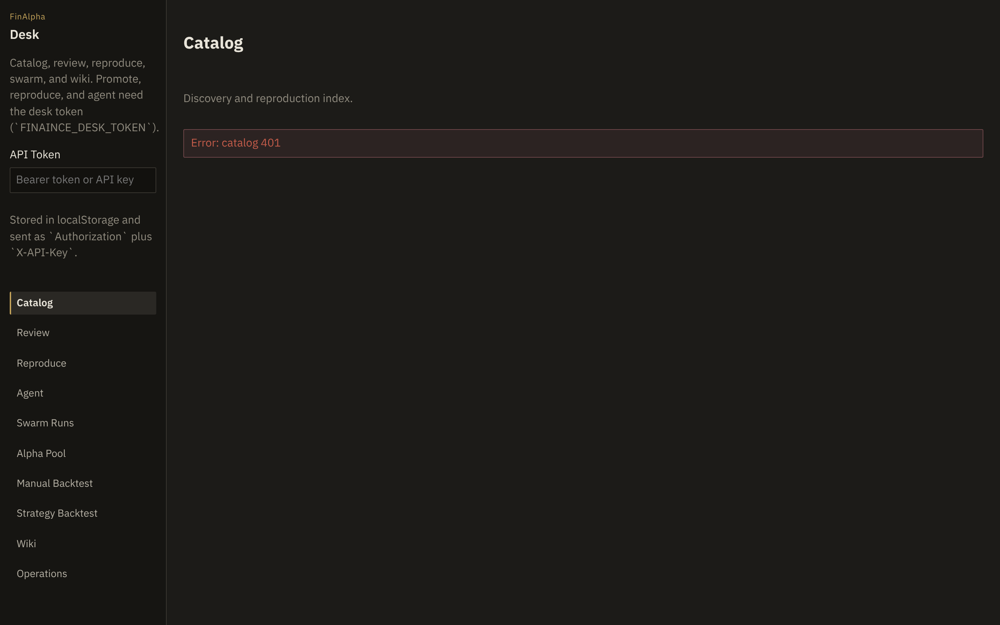

若需将服务绑定到 `0.0.0.0`，必须同时设置 `FINAINCE_ALLOW_PUBLIC_BIND=1`。

---

## 4. Web 工作台界面导览

左侧导航栏包含 Catalog、Review、Reproduce、Agent、Swarm Runs、Alpha Pool、Manual Backtest、Strategy Backtest、Wiki 与 Operations。填入的 Token 保存在浏览器 `localStorage` 中，请求时自动注入 `Authorization: Bearer …` 与 `X-API-Key` 请求头。

### 4.1 Catalog（因子目录）

因子挖掘、沙箱实现与研报复现共用同一张目录表。下图中展示了研报复现写入的 `mock_momentum`（状态 `review`）与沙箱实现写入的 `rank_delta`（状态 `candidate`）：


点击任意一行可查看因子表达式、股票池（universe）、门禁标记，并可点击提交晋升申请（HTTP 提交只进入待审队列，不会直接写进因子池）：

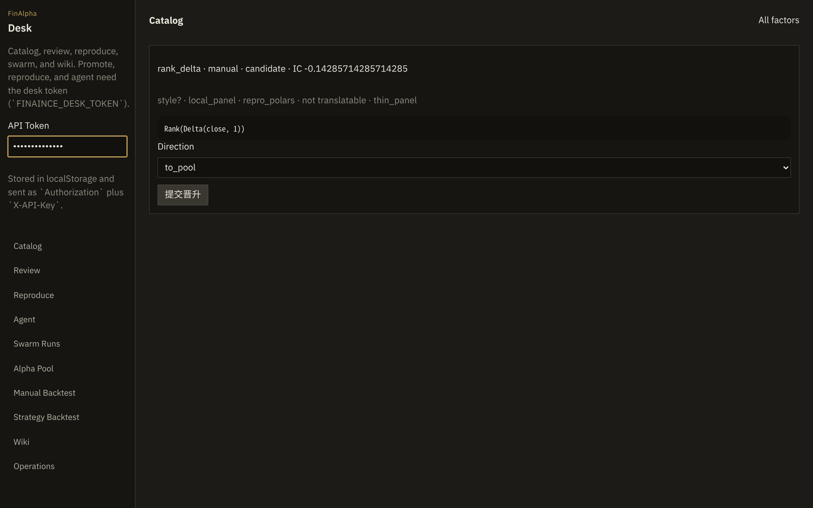

### 4.2 Review（晋升复核队列）

展示所有待审批的晋升请求。下图中该记录目标为 `to_pool`、状态为 `pending`，门禁拦截原因为 `thin_panel`。Web 界面上的 **Approve** 按钮不携带任何 override，且须等对抗重评通过后才允许点击：

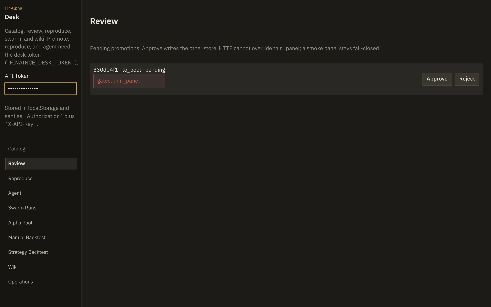

### 4.3 Reproduce（研报复现）

通过 HTTP 接口提交 PDF 复现任务时，`pdf_path` 必须位于环境变量 `FINAINCE_PDF_ROOT` 指定的目录树内，否则返回 `403`（命令行 `finaince reproduce` 直接读取本地路径，不受此白名单限制）：

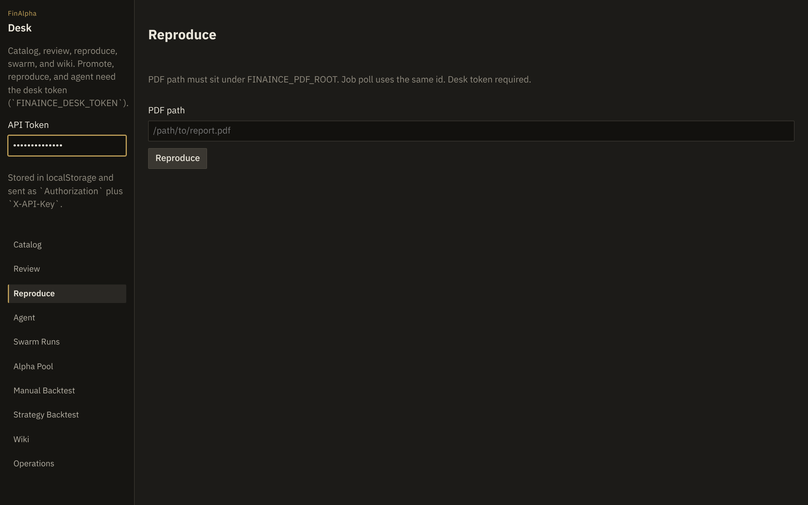

### 4.4 Agent（研究台对话）

将自然语言指令路由至 Catalog、Eval、Reproduce 与 Review 工具链，所有指标均由底层确定性引擎产出，模型自身不编造回测数字。完整对话需安装 `.[agent]` 且本机具备 `claude` CLI：

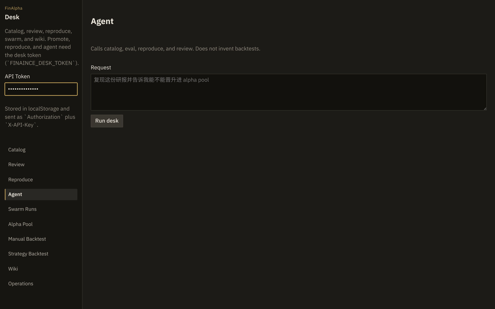

### 4.5 Swarm、Alpha Pool、回测、Wiki 与运维

以下页面挂载自同源的 `aiminer` 前端工作台，与 FinAlpha Catalog 共享数据库状态与鉴权口令：

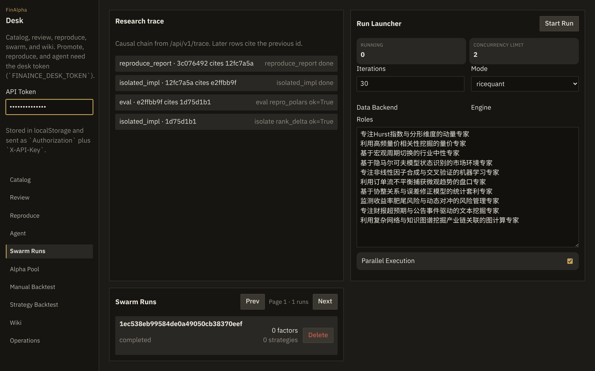

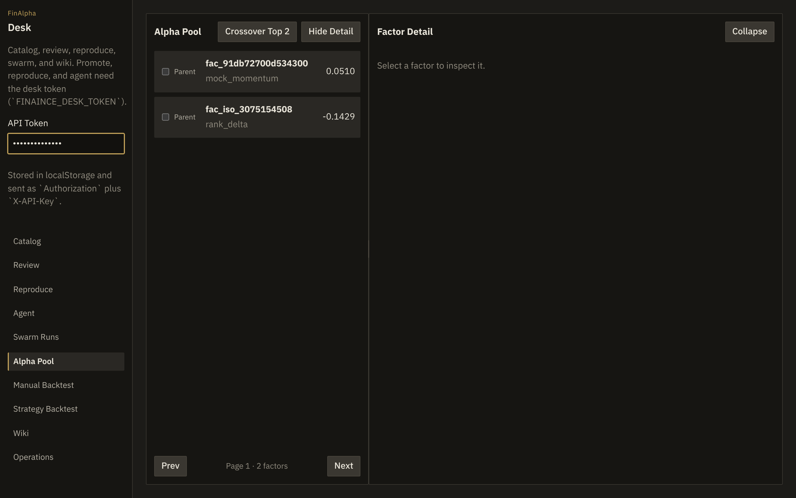

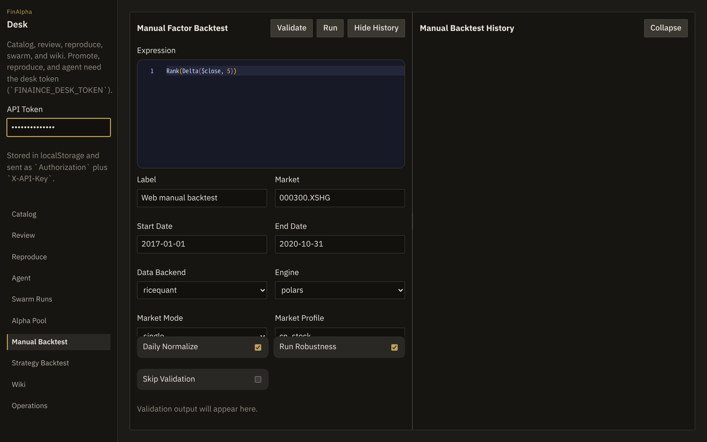

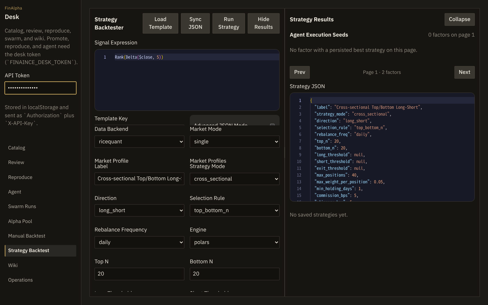

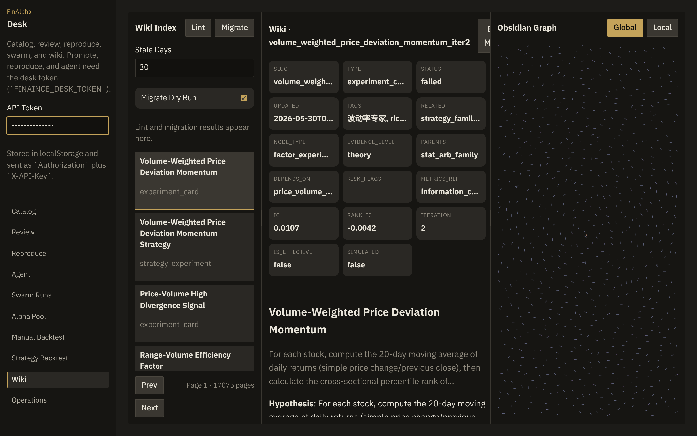

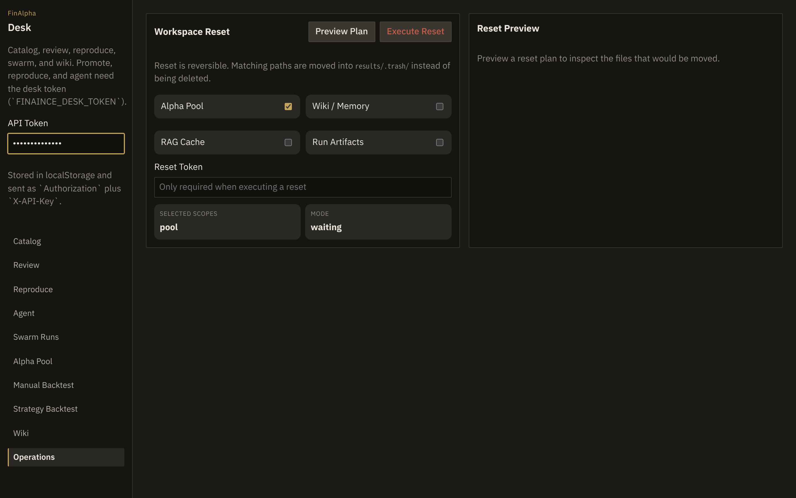

---

## 5. CLI 命令速查表

可通过 `finaince --help` 查看全部子命令：

| 命令 | 功能说明 |
|---|---|
| `doctor` | 检查运行目录、模块导入、行情面板、Qlib 子进程与 LLM 配置（`--audit-check` 校验审计哈希链；`--watch/--iterations/--interval` 周期巡检） |
| `baseline` | 在内置两只股票面板上运行固定窗口探针测试（Python 侧 `run_locked_baseline(cost_bps=…)` 支持传入交易成本） |
| `eval EXPR --dialect repro_polars\|qlib --backend local\|pit\|ricequant\|auto --cost-bps N` | 因子表达式评测。`--backend pit` 与 `bench` 共用可引用的点时核（`pit_core`）；`--backend local` 走 `engine_native`（`citable=false`） |
| `validate EXPR` | 使用 Polars 引擎校验因子表达式语法与算子合法性 |
| `impl PATH.py --name NAME --universe local_panel` | 在隔离沙箱中执行 `compute(panel)` 并将结果登记至 Catalog |
| `reproduce PDF --sync [--start --end --source]` | 解析券商 PDF 研报并执行回测验证，支持指定时间窗口与数据源 |
| `catalog [--source SRC] [--rebuild] [--retag-synthetic]` | 查看或从上游记录重建本地因子目录 |
| `library [-q QUERY] [--style STYLE]` | 跨本地 Catalog 与引擎因子库检索因子（支持按风格标签过滤） |
| `promote ID --to to_pool --yes` | 将指定 Catalog 记录提交至晋升复核队列 |
| `review` / `--approve ID [--override ...] [--no-adversary]` / `--reject ID` | 查看或审批复核队列。`approve` 默认运行子进程对抗重评；`--override` 仅能豁免指定的统计/样本门禁，无法豁免 `unprovenanced` 与 `not_citable` |
| `discover --demo` | 不调用大模型，在本地演示一轮 IC 与相关性淘汰（cull） |
| `discover --swarm --sync/--async` | 启动 `aiminer` 多智能体因子挖掘（需配置 LLM） |
| `serve --host 127.0.0.1 --port 8000` | 启动同源 Web 工作台与 `/api/v1` 服务 |
| `jobs [--cancel ID]` | 查看后台异步任务队列或终止指定任务进程树 |
| `trace [--limit N]` | 查看带假设（hypothesis）与引用（cites）的研究事件审计链 |
| `loop [--steps N] [--expression EXPR]... [--sync/--async] [--workers N]` | 交替执行因子评测步与 Walk-Forward 曲线择时步；未给 `--expression` 且无 sweep 产物时返回 `expression_queue_empty` |
| `bench [--is-start --is-end --oos-start --oos-end --cost-bps] [--sync] [--expression EXPR] [--neutralize-industry]` | 在点时 CSI300 缓存上生成带溯源元数据的 IS/OOS 双窗基准表（`--sync` 需米筐凭证；`--cost-sweep` 输出成本敏感度；无 `industry` 列时诚实声明跳过行业中性化） |
| `walkforward [--start --end --cost-bps --neutralize-vs]` | 种子因子逐年折叠稳健性检验，输出各年 IC 均值、标准差与正 IC 年份占比 |
| `sweep [--top --workers --rank-by --windows --dedup-catalog]` | 在 `pit_core` 上并行扫描算子模板 $\times$ 字段 $\times$ 窗口网格，输出 JSON 与 Markdown 筛选报告 |
| `wf-candidates [--top N --from-sweep PATH --rank-by --cost-bps --workers --per-family K --combine-top N --rebalance-every M]` | 读取筛选产物中的 Top-N 候选执行逐年折叠检验，支持按模板家族限额（`--per-family`）、截面名次合成（`--combine-top`）与低频调仓步长（`--rebalance-every`） |
| `campaign --root DIR [--limit N] [--stats] [--reset-failed]` | 批量复现指定目录下的券商 PDF 研报，支持 `.manifest.json` 断点续跑与 `no_factors` 诚实记账 |
| `brain-submit EXPR [--catalog-id ID]` | 将通过治理流的因子提交至 WorldQuant BRAIN 平台裁决；无凭据时自动降级为内部双窗基准 |
| `agent PROMPT --max-turns N` | 通过 Claude Agent SDK 执行单轮研究台指令 |
| `sdk-info` / `sdk-query --prompt` | 查看 SDK 工具链注册状态或发起直连查询 |

---

## 6. 晋升门禁一览

候选因子向因子池（`to_pool`）或因子库（`to_library`）晋升时，需通过以下门禁检查：

| 门禁标识 | 触发拦截条件 | 是否允许 CLI `--override` |
|---|---|:---:|
| `unprovenanced` | 缺少评测核标识（`engine`）或缺少回测起止日期（`window_start` / `window_end`） | **否** |
| `not_citable` | `citable=false`（包括所有 `engine_native` 与 `engine=unknown` 记录） | **否** |
| `simulated` | 记录被标记为模拟合成数据 | 是 |
| `formula_proxy` | 研报复现使用了占位代理公式而非真实抽取得出的表达式 | 是 |
| `thin_panel` | 实际载入的行情面板股票数量少于 20 只（无论 `universe` 字段如何命名） | 是 |
| `missing_ic` | IC 缺失或为非有限浮点数（`NaN` / `Inf`） | 是 |
| `ic_threshold` | $|IC| \le 0.005$ | 是 |
| `missing_returns` | 缺少每日多空收益序列（`daily_returns` 为空） | 是 |
| `correlated` | 与目标池内已有因子的日收益序列相关系数 $> 0.7$ | 是 |
| `empty_code` | 向 `to_pool` 晋升时无法映射出有效的算子代码 | 是 |
| `weak_ic` | Harvey–Liu $t$ 统计量 $|ICIR| \times \sqrt{N_{\text{days}}} < 3.0$（观测日不足时标记 `insufficient_for_t_stat`） | 是 |
| `inflated_sharpe` | Bailey–López de Prado 缩减夏普比率 $\text{DSR} < 0.95$（试验次数从审计链中的评测事件累计） | 是 |
| `homogeneous` | 与种子库或 Catalog 已有因子的最大 AST 子树同构相似度 $> 0.85$ | 是 |
| `overcomplex` | AST 符号节点数 $> 40$、自由参数 $> 6$ 或引用特征数 $> 8$ | 是 |
| `corr_error:{exc}` | 相关性计算过程抛出异常，按默认拒止拦截 | 是 |

所有通过 CLI `--override` 放行的门禁均会记入不可篡改的审计哈希链；HTTP 接口拒绝任何 `override`。

---

## 7. HTTP API 接口契约

服务默认绑定 `127.0.0.1:8000`，CORS 默认仅放行本地 `8000` 与 `5173` 端口。鉴权支持 `Authorization: Bearer <token>` 或 `X-API-Key: <token>`。

| 端点与方法 | 鉴权要求 | 行为说明 |
|---|---|---|
| `GET /`、`GET /api/v1/health`、`GET /api/v1/baseline` | 公开 | 返回工作台首页、服务健康状态与锁定探针基准结果 |
| `GET /api/v1/catalog`、`/catalog/{id}`（支持 `?embed=memory`） | 需 Desk Token | 查询因子目录列表与单条详情 |
| `GET /api/v1/review`、`/review/{id}/gates` | 需 Desk Token | 查询待审晋升队列与只读门禁检查报告 |
| `GET /api/v1/jobs`、`/jobs/{id}`、`/audit`、`/trace`、`/bench` | 需 Desk Token | 查询异步作业、审计链、研究事件链与点时基准表 |
| `POST /api/v1/eval`、`/promote`、`/impl`、`/impl/needs`、`/agent` | 需 Desk Token | 触发因子评测（透传 `cost_bps`）、提交晋升、沙箱执行与 Agent 对话 |
| `POST /api/v1/loop` | 需 Desk Token | 支持传入 `expressions` 队列、`sync: false` 异步执行与 `workers: 1..8` 进程池并行 |
| `POST /api/v1/jobs/{id}/cancel` | 需 Desk Token | 终止指定异步任务进程树（先发 `SIGTERM`，超时自动升级 `SIGKILL`） |
| `POST /api/v1/review/{id}/adversary` | 需 Desk Token | 仅运行独立子进程重评并返回对比报告，不改变晋升状态 |
| `POST /api/v1/review/{id}/approve` | 需 Desk Token | 强制执行对抗重评；请求体若包含 `override` 固定返回 **403**；若将 `adversary` 设为非 `true` 固定返回 **400** |
| `POST /api/v1/review/{id}/reject` | 需 Desk Token | 驳回晋升请求 |
| `POST /api/v1/reproduce` | 需 Desk Token | 触发 PDF 研报复现；若 `pdf_path` 不在 `FINAINCE_PDF_ROOT` 目录内固定返回 **403** |

---

## 8. 环境变量速查表

可基于仓库根目录的 [`.env.example`](../.env.example) 创建 `.env`：

| 环境变量 | 说明 |
|---|---|
| `FINAINCE_DESK_TOKEN` | Web 工作台与 `/api/v1` 接口访问口令（同时同步至 `AIMINER_AUTH_TOKEN`） |
| `FINAINCE_DATA_SOURCE` | 数据源模式（如 `local`） |
| `FINAINCE_PANEL_PATH` | 指定完整行情 Parquet 文件路径（列结构与 `prices.parquet` 一致），替代内置两只股票探针面板 |
| `FINAINCE_LOCAL_DATA_PATH` | 本地行情数据目录（供 `qlib_child` 读取） |
| `FINAINCE_BT_START` / `FINAINCE_BT_END` | 覆盖默认回测起止日期 |
| `FINAINCE_PDF_ROOT` | HTTP 接口 `/api/v1/reproduce` 允许读取的 PDF 根目录白名单 |
| `FINAINCE_PACKAGED_SPA=1` | 强制使用包内自带的三栏式轻量首页，忽略同级 `aiminer/frontend/dist` |
| `FINAINCE_ALLOW_PUBLIC_BIND=1` | 允许 `finaince serve` 绑定非回环地址（如 `0.0.0.0`） |
| `FINAINCE_PATH_HACK=1` | 开发调试模式下允许注入同级本地兄弟仓库源码 |
| `FINAINCE_NO_PATH_HACK=1` | CI 与洁净环境安装测试时强制禁用本地路径注入 |
| `ALLOW_MOCK_LLM=true` | 离线测试时启用模拟公式抽取 |
| `RQ_TOKEN` 或 `RQ_USER` + `RQ_PASS` | 米筐（RiceQuant）行情凭证，供 `finaince bench --sync` 使用 |
| `BRAIN_USER` / `BRAIN_PASS` | WorldQuant BRAIN 平台凭证；未配置时自动降级为内部双窗基准 |
| `FINAINCE_LLM_PROVIDER` / `FINAINCE_LLM_MODEL` / `FINAINCE_LLM_API_KEY` / `FINAINCE_LLM_BASE_URL` | 对话与代码进化所用的大模型接口配置 |
| `FINAINCE_LOOP_ADVISOR=1` | 在 `finaince loop` 中启用大模型动作建议（失败时自动回退至启发式规则） |
| `FINAINCE_MODEL_HEAD=ols\|gbm` | 选择研究循环中的 Walk-Forward 曲线择时模型头（`gbm` 需安装 `.[gbm]`） |
| `FINAINCE_PANEL_CACHE=off` | 关闭进程级本地面板内存缓存（默认开启） |
| `FINAINCE_MAX_JOBS=N` | 后台异步作业最大并发槽位数（默认 `2`，超出返回 `max_jobs_reached`） |
| `FINAINCE_SANDBOX=bwrap\|auto\|off` | 沙箱隔离策略：`auto` 在检测到 `bwrap` 时自动启用无网络容器隔离 |
| `FINAINCE_QLIB_SUBPROCESS=1` | 将 Qlib 评测委托给独立 Python 3.10 子进程（配合 `AIMINER_PYTHON`） |
| `FINAINCE_CATALOG=0` | 关闭引擎回测至 Catalog 的自动双写钩子 |
| `FINAINCE_CATALOG_MEMORY=1` | 查询 `/api/v1/catalog/{id}` 时默认内嵌过程记忆摘要 |

---

## 9. 自动化测试

运行全量离线单元测试（无需网络或外部凭证）：

```bash
python -m pytest tests --ignore=tests/test_live_real.py
```

GitHub Actions 在每次提交时运行 `packaging-312`（设置 `FINAINCE_NO_PATH_HACK=1` 验证洁净公开安装）与 `pytest-offline`。涉及米筐、真实券商 PDF 与在线大模型的集成测试归入 `pytest -m live`，仅在配置好相应凭证时按需运行。
